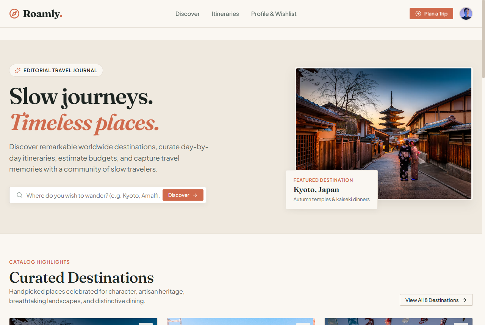
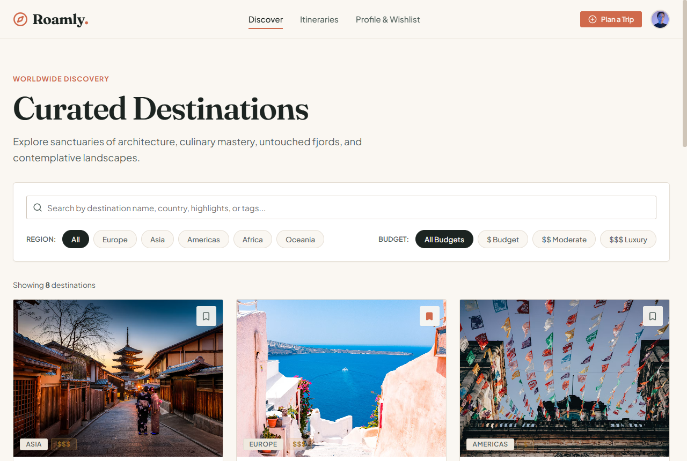
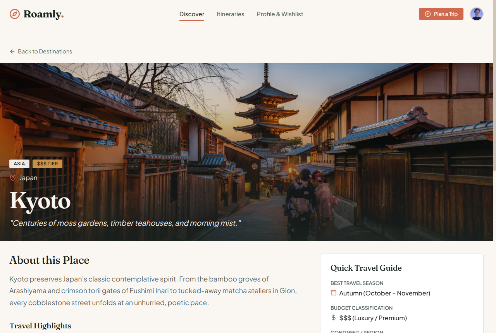
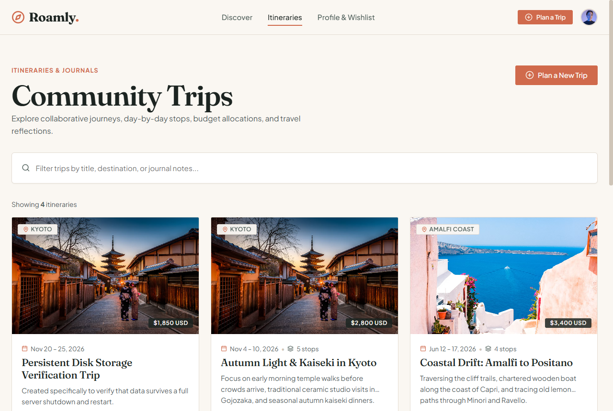
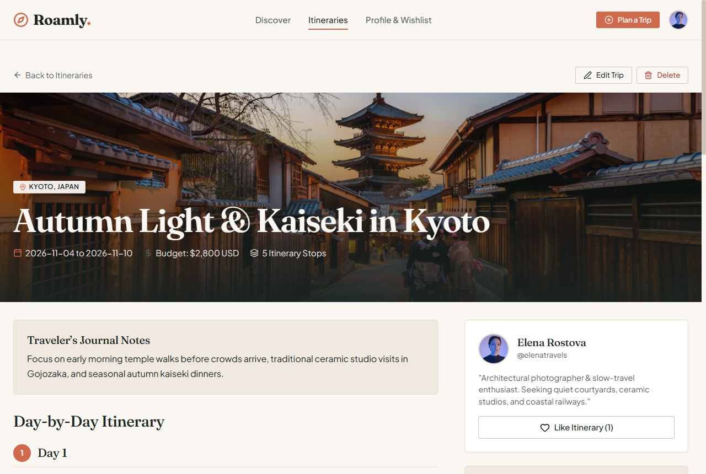
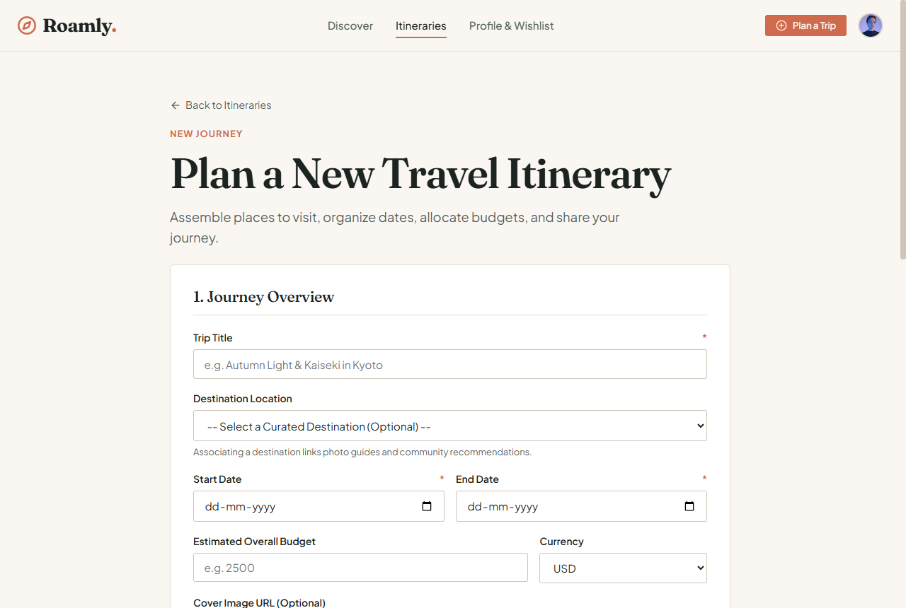
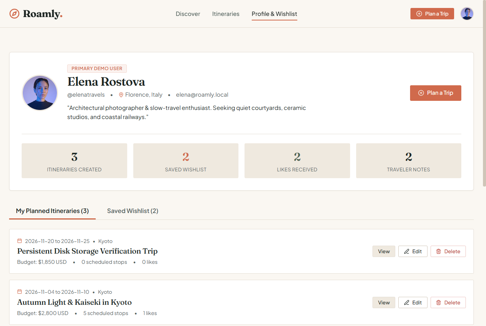

# Roamly — Discover. Plan. Remember.

A polished full-stack travel discovery and collaborative trip-planning web application built for the **Full Stack Developer Internship Technical Assignment (Rewamp Digital)**.

**Candidate Submission Deadline:** 25 October 2026, 12:00 PM IST.

---

## Table of Contents

- [1. Technical Stack Overview](#1-technical-stack-overview)
- [2. Rewamp Digital Assignment Requirements Matrix](#2-rewamp-digital-assignment-requirements-matrix)
- [3. Architecture Overview](#3-architecture-overview)
- [4. Core Features & User Workflows](#4-core-features--user-workflows)
- [5. Project Structure](#5-project-structure)
- [6. Local Setup & Execution Guide](#6-local-setup--execution-guide)
- [7. Verification & Testing](#7-verification--testing)
- [8. Application Screenshots & Visual Tour](#8-application-screenshots--visual-tour)
- [9. REST API Reference](#9-rest-api-reference)
- [10. Editorial Design System Tokens](#10-editorial-design-system-tokens)

---

## 1. Technical Stack Overview

- **Frontend**: React 19 (`^19.3.1`), Vite (`^8.3.4`), React Router 7 (`^7.18.4`), Lucide React Icons (`^1.60.0`).
- **Styling**: Bespoke Editorial Vanilla CSS Design System with custom design tokens (warm ivory, sand, terracotta, sage, ochre, deep ink). Zero AI-dashboard templates, zero generic blue gradients, zero third-party CSS frameworks.
- **Backend**: Node.js (`v24.21.0`), Express (`v4.21.2`), Native SQLite (`node:sqlite`).
- **Database Engine**: Persistent disk SQLite file (`backend/data/roamly.db`) utilizing Node.js 24 native `DatabaseSync` engine, Write-Ahead Logging (WAL) journaling, foreign key cascade enforcement, and atomic transactions.
- **Testing & Verification**: Automated end-to-end integration test suite exercising all 11 mandatory assignment requirements (33/33 tests passing) plus frontend code quality verification via `oxlint`.

---

## 2. Rewamp Digital Assignment Requirements Matrix

| # | Requirement | Implementation in Roamly | Verification Status |
| :-: | :--- | :--- | :--- :--- |
| **1** | **Home page** | Editorial landing with brand manifesto, destination spotlights, quick search, and trending community itineraries. | Verified (`/`) |
| **2** | **Listing and details** | Curated catalog at `/destinations` & `/destinations/:id`; Itinerary directory at `/trips` & `/trips/:id`. | Verified |
| **3** | **Create and update** | Full trip creation & itinerary editor at `/trips/new` and `/trips/:id/edit` with day-by-day stops and budget calculations. | Verified |
| **4** | **Delete** | Author-verified trip and comment deletion with confirmation modals and cascading cleanup. | Verified |
| **5** | **Interactions** | **3 Real interactions**: Wishlist Bookmarking (destinations), Likes (trips), and live Discussion Comments. | Verified |
| **6** | **Search & filtering** | Keyword search across titles, countries, and tags; Filter pills by Continent (Region) and Budget Tier (`$`, `$$`, `$$$`). | Verified |
| **7** | **User profile** | Profile page (`/profile`) showing Elena Rostova's bio, home city, stats, created trips, and saved wishlist items. | Verified |
| **8** | **Backend API** | Structured REST API with validation, clean JSON responses, 404 handlers, and centralized error logging. | Verified (`/api/*`) |
| **9** | **Database persistence** | SQLite database file (`roamly.db`) persisting on disk across server shutdowns and restarts. | Verified |
| **10** | **Validation & error handling** | Form validation, date sequence checks, negative budget prevention, HTTP 400/403/404/500 codes, loading skeletons, and empty states. | Verified |
| **11** | **Responsive UI** | Fluid layouts optimized for mobile (360px), tablet (640px), and desktop (1024px–1440px) with responsive navigation drawer. | Verified |

---

## 3. Architecture Overview

Roamly uses a decoupled client-server architecture with an integrated development proxy, native database engine, and strict separation of concerns:

```text
┌────────────────────────────────────────────────────────────────────────┐
│                        BROWSER CLIENT (SPA)                           │
│  React 19 • React Router 7 • Lucide Icons • Editorial Vanilla CSS      │
│  Dev Server: http://localhost:5173                                    │
└──────────────────┬────────────────────────────────▲───────────────────┘
                   │                                │
                   │  /api/* requests (Fetch API)   │  JSON responses
                   ▼                                │
┌──────────────────┴────────────────────────────────┴───────────────────┐
│                    VITE DEVELOPMENT SERVER PROXY                       │
│  Target: http://localhost:5000 (Eliminates CORS in development)       │
└──────────────────┬────────────────────────────────▲───────────────────┘
                   │                                │
                   ▼                                │
┌──────────────────┴────────────────────────────────┴───────────────────┐
│                      EXPRESS REST API BACKEND                          │
│  Node.js (v24.21.0 / v22.5+) • Express 4.21 • Port 5000               │
│  Sub-Routers: /api/destinations, /api/trips, /api/profile, etc.       │
│  Middleware: resolveUser, validatePayload, errorHandler, 404Handler    │
└──────────────────┬────────────────────────────────▲───────────────────┘
                   │                                │
                   ▼                                │
┌──────────────────┴────────────────────────────────┴───────────────────┐
│                   NATIVE SQLITE DATABASE ENGINE                        │
│  Node.js 24 native 'node:sqlite' DatabaseSync engine                  │
│  WAL Journaling • Foreign Key Cascades • Atomic Transactions          │
│  Persistent Disk File: backend/data/roamly.db (7 Relational Tables)   │
└────────────────────────────────────────────────────────────────────────┘
```

### Architectural Highlights
1. **Client Tier**: Single-page application using React 19 and React Router 7. Features an editorial layout with responsive navigation drawer, modular cards, loading skeletons, and a centralized `api.js` client.
2. **Proxy Tier**: Vite dev server forwards all `/api/*` requests directly to `http://localhost:5000`, matching production reverse-proxy setups.
3. **Server Tier**: RESTful Express service with route-level middleware for request validation, author-ownership authorization (returning HTTP 403 on mismatched user ID), and centralized error handling.
4. **Persistence Tier**: Pure native SQLite (`node:sqlite`) with zero native C++ compile steps, automatic database schema generation on initial boot, disk persistence across restarts, and atomic transactions (`BEGIN` / `COMMIT` / `ROLLBACK`) for multi-stop itinerary mutations.

---

## 4. Core Features & User Workflows

### Curated Destinations Catalog (`/destinations` & `/destinations/:id`)
- **Discovery Catalog**: 8 seed destinations across Europe, Asia, Americas, and Africa (Kyoto, Amalfi Coast, Oaxaca, Reykjavik, Chefchaouen, Queenstown, Porto, Banff).
- **Search & Filtering**: Real-time keyword search across destination titles, countries, and tags; Filter pills by continent (All, Europe, Asia, Americas, Africa, Oceania) and budget tier (`$`, `$$`, `$$$`).
- **Destination Guide**: Narrative overview, optimal season, budget tier, continent/country tags, and associated community itineraries.
- **Wishlist Interaction**: Instant bookmark toggle with optimistic UI updates.

### Collaborative Trip Planning & Itineraries (`/trips`, `/trips/new`, `/trips/:id`)
- **Community Itineraries**: Directory of travel itineraries with author info, destination tags, travel dates, stop counts, budget estimates, and like counts.
- **Day-by-Day Stop Builder**: Dynamic stops editor categorized by `Stay`, `Food`, `Culture`, `Nature`, `Activity`, and `Transit` with individual cost tracking and automatic budget summation.
- **Author Ownership Security**: Only the author of a trip can modify or delete it. Non-owners receive HTTP 403 Forbidden. Deletions cascade cleanly to all associated stops, likes, and comments.

### Real User Interactions
- **Interaction 1: Wishlist Bookmarks**: Save/unsave destinations directly from cards or detail views.
- **Interaction 2: Itinerary Likes**: Toggle likes on trips with live like count counters.
- **Interaction 3: Discussion Comments**: Real-time discussion thread on each trip with author attribution and author-only comment deletion.

### User Profile Dashboard (`/profile`)
- Displays user bio, home city, avatar, and aggregated travel statistics (trips planned, destinations saved).
- Tabbed views for "My Itineraries" and "Saved Wishlist" for quick trip management.
- Defaults to primary demo user **Elena Rostova** (User ID 1) with seamless context resolution.

---

## 5. Project Structure

```text
d:/Internship/
├── backend/
│   ├── data/
│   │   └── roamly.db              # Persistent SQLite database file
│   ├── src/
│   │   ├── config/
│   │   │   ├── db.js              # DatabaseSync connection & transaction wrapper
│   │   │   ├── schema.js          # DDL definitions for the 7 relational tables
│   │   │   └── seed.js            # Curated destinations, demo users & itineraries
│   │   ├── controllers/
│   │   │   ├── destinationController.js # Catalog, search, filters & details
│   │   │   ├── interactionController.js # Bookmarks, likes & comments
│   │   │   ├── profileController.js     # User stats, trips & wishlists
│   │   │   └── tripController.js        # Trip CRUD & multi-stop sync
│   │   ├── middleware/
│   │   │   ├── errorHandler.js    # 404 & Centralized JSON error handler
│   │   │   └── validate.js        # Payload & parameter validation rules
│   │   ├── routes/
│   │   │   ├── destinationRoutes.js
│   │   │   ├── interactionRoutes.js
│   │   │   ├── profileRoutes.js
│   │   │   ├── tripRoutes.js
│   │   │   └── index.js           # API route aggregator mounted at /api
│   │   └── server.js              # Express app entry point (port 5000)
│   ├── test/
│   │   └── api_test.js            # Automated E2E test suite (33 assertions)
│   ├── .env.example
│   ├── package.json
│   └── README.md
├── frontend/
│   ├── public/
│   │   └── favicon.svg            # Custom terracotta & ink compass icon
│   ├── src/
│   │   ├── assets/
│   │   │   └── hero.png           # Hero banner artwork
│   │   ├── components/
│   │   │   ├── common/            # DestinationCard, TripCard, LoadingSkeleton, EmptyState, ConfirmModal, ErrorBanner
│   │   │   └── layout/            # Navbar with responsive drawer, Footer with credits
│   │   ├── context/
│   │   │   └── ToastContext.jsx   # Global toast notification provider
│   │   ├── pages/                 # Home, Destinations, DestinationDetail, Trips, TripDetail, CreateEditTrip, Profile
│   │   ├── services/
│   │   │   └── api.js             # Centralized API fetch wrapper with /api proxy
│   │   ├── styles/                # variables.css, base.css, components.css, layout.css
│   │   ├── App.css
│   │   ├── App.jsx                # Client router shell
│   │   ├── index.css              # Master styling entry
│   │   └── main.jsx
│   ├── .oxlintrc.json             # Code quality and React hook rules
│   ├── index.html
│   ├── vite.config.js             # Dev server & proxy configuration to port 5000
│   ├── package.json
│   └── README.md
├── docs/
│   └── screenshots/               # Verified full-resolution application screenshots
├── .gitignore
└── README.md
```

---

## 6. Local Setup & Execution Guide

### Prerequisites
- **Node.js**: `v22.5.0` or higher (`v24.21.0` recommended for native `node:sqlite` support)
- **npm**: `v10.0.0` or higher

### Step 1: Start the Backend API Server
1. Navigate to the `backend/` directory:
   ```bash
   cd backend
   ```
2. Install dependencies:
   ```bash
   npm install
   ```
3. Create the environment configuration:
   ```bash
   # Unix / macOS / PowerShell
   cp .env.example .env

   # Windows Command Prompt
   copy .env.example .env
   ```
4. Launch the backend in development mode:
   ```bash
   npm run dev
   ```
   The backend API will start on **`http://localhost:5000`**. On first run, it automatically seeds the database with 8 worldwide destinations, 2 users, 3 sample itineraries with 13 stops, bookmarks, likes, and comments.

### Step 2: Start the Frontend Application
Open a second terminal window:
1. Navigate to the `frontend/` directory:
   ```bash
   cd frontend
   ```
2. Install dependencies:
   ```bash
   npm install
   ```
3. Launch the Vite development server:
   ```bash
   npm run dev
   ```
   Open **`http://localhost:5173`** in your web browser. All `/api` requests are automatically proxied to the backend on port 5000.

### Step 3: Production Build (Optional)
To verify the production build bundle:
```bash
cd frontend
npm run build
npm run preview
```

---

## 7. Verification & Testing

### Backend Automated End-to-End Test Suite
Run the test suite exercising all 11 assignment requirements:
```bash
cd backend
npm run test:api
```
**Verification Scope:**
- System health check & root welcome metadata.
- Destination listing, title search, continent filtering, and budget filtering.
- Destination details and related itinerary association.
- Wishlist bookmark toggle and bookmarks retrieval.
- Trip creation with multi-day itinerary stops (atomic transaction).
- Validation edge cases: Missing required fields, invalid date sequences (`start_date > end_date`), negative budgets.
- Trip updates with stop synchronization.
- Ownership authorization: Non-author update rejection (HTTP 403).
- Non-author trip deletion rejection (HTTP 403).
- Authorized trip deletion with cascading cleanup of stops, likes, and comments.
- Trip like toggle and live counter verification.
- Trip discussion comments post and delete operations.
- User profile data, aggregate travel statistics, and wishlist retrieval.
- Database persistence across server restarts.

Expected result:
```text
========================================
TEST RESULTS: 33/33 PASSED (0 FAILED)
========================================
```

### Frontend Code Quality & Linting
Run the frontend linter:
```bash
cd frontend
npm run lint
```
Executes `oxlint` with React Hooks and component rules across all frontend source files (0 errors).

---

## 8. Application Screenshots & Visual Tour

The application views below were captured directly from the live Roamly application running locally (`http://localhost:5173`) with the backend API service (`http://localhost:5000`):

### View 1: Editorial Homepage (`/`)
- **Route**: `/`
- **Key Features Highlighted**: Brand manifesto, quick destination search bar, continent spotlight carousel, trending community itineraries with like counts and author attribution.



---

### View 2: Curated Destinations Catalog (`/destinations`)
- **Route**: `/destinations`
- **Key Features Highlighted**: Live keyword search, Continent filter pills (`Europe`, `Asia`, `Americas`, etc.), Budget tier indicators (`$`, `$$`, `$$$`), and instant wishlist bookmark toggles.



---

### View 3: Destination Detail Page (`/destinations/:id`)
- **Route**: `/destinations/1` (Kyoto, Japan)
- **Key Features Highlighted**: Immersive cover hero imagery, narrative editorial overview, optimal travel season, budget tier classification, and interactive wishlist bookmarking.



---

### View 4: Community Itineraries Directory (`/trips`)
- **Route**: `/trips`
- **Key Features Highlighted**: Community itinerary listing, travel dates, destination association, total stops counter, estimated budget badges, and live like counters.



---

### View 5: Day-by-Day Itinerary Detail (`/trips/:id`)
- **Route**: `/trips/1` (Autumn Light & Kaiseki in Kyoto)
- **Key Features Highlighted**: Chronological day-by-day stops timeline with category badges (`Stay`, `Food`, `Culture`, etc.), author profile card, interactive like counter, author-only Edit/Delete controls, and discussion comments feed.



---

### View 6: Trip Creation & Itinerary Editor (`/trips/new`)
- **Route**: `/trips/new`
- **Key Features Highlighted**: Complete trip authoring form, curated destination selector, start/end date validation, currency and budget inputs, cover image URL, and dynamic day-by-day stops editor with real-time budget summation.



---

### View 7: User Profile Dashboard (`/profile`)
- **Route**: `/profile`
- **Key Features Highlighted**: Active demo user profile (`Elena Rostova`), avatar, bio, home city, aggregate travel stats (itineraries created, saved wishlists), and tabbed views for "My Planned Itineraries" and "Saved Wishlist".



---

## 9. REST API Reference

All backend routes are mounted under `/api` and respond with standardized JSON:

| Method | Endpoint | Description | Auth / Owner Required |
| :--- | :--- | :--- | :---: |
| `GET` | `/` | Root welcome endpoint returning API status, version, and health link | No |
| `GET` | `/api/health` | Health check returning service status and active demo user | No |
| `GET` | `/api/destinations` | List destinations with optional `search`, `continent`, `budget_tier` filters | No |
| `GET` | `/api/destinations/:id` | Get single destination by ID with associated itineraries | No |
| `POST` | `/api/destinations/:id/bookmark` | Toggle saved wishlist bookmark for active user | Yes (`x-user-id`) |
| `GET` | `/api/bookmarks` | List all saved destinations for active user | Yes (`x-user-id`) |
| `GET` | `/api/trips` | List itineraries with optional `search`, `destination_id`, `user_id` filters | No |
| `GET` | `/api/trips/:id` | Get trip details with day-by-day stops, comments, and like status | No |
| `POST` | `/api/trips` | Create new trip with optional day-by-day stops (atomic transaction) | Yes (`x-user-id`) |
| `PUT` | `/api/trips/:id` | Update existing trip and synchronize stops | **Owner Only** (403 if mismatched) |
| `DELETE` | `/api/trips/:id` | Delete trip (cascades to stops, likes, comments) | **Owner Only** (403 if mismatched) |
| `POST` | `/api/trips/:id/like` | Toggle like status on an itinerary | Yes (`x-user-id`) |
| `POST` | `/api/trips/:id/comments` | Post a new comment on an itinerary | Yes (`x-user-id`) |
| `DELETE` | `/api/comments/:id` | Delete a comment | **Author Only** (403 if mismatched) |
| `GET` | `/api/profile` | Get active user profile, stats, created trips, and bookmarks | Yes (`x-user-id`) |
| `GET` | `/api/profile/:id` | Get profile for specific user ID | No |

---

## 10. Editorial Design System Tokens

Located at `frontend/src/styles/variables.css`:

```css
:root {
  /* Core Editorial Palette */
  --color-ivory: #FAF7F2;              /* Warm parchment background */
  --color-sand: #EFE9DF;               /* Secondary container and pill surface */
  --color-sand-hover: #E4DDD1;
  --color-ink: #1C2421;                /* High-contrast deep slate text */
  --color-ink-muted: #53625D;          /* Secondary descriptive body copy */
  --color-ink-faint: #8B9A95;          /* Subtle metadata and borders */
  --color-terracotta: #D06A4C;         /* Primary brand accent */
  --color-terracotta-hover: #B7563A;
  --color-sage: #4F6352;               /* Organic secondary accent */
  --color-ochre: #D99E4B;              /* Warm golden highlight */
  --color-border: #E4DDD3;

  /* Typography */
  --font-serif: 'Fraunces', Georgia, serif;
  --font-sans: 'Plus Jakarta Sans', -apple-system, sans-serif;
  --font-mono: ui-monospace, Menlo, Consolas, monospace;

  /* Component Metrics */
  --radius-sm: 3px;
  --radius-md: 6px;
  --radius-lg: 10px;
  --radius-pill: 9999px;
  --max-width: 1280px;
}
```
